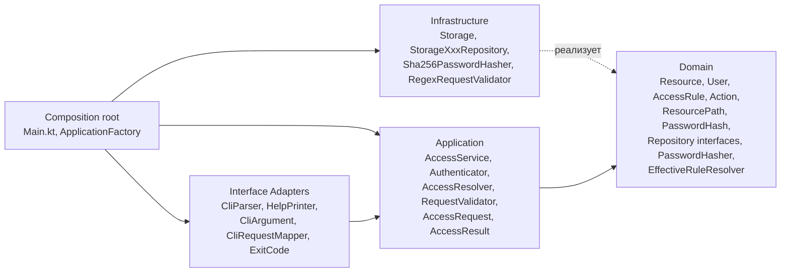
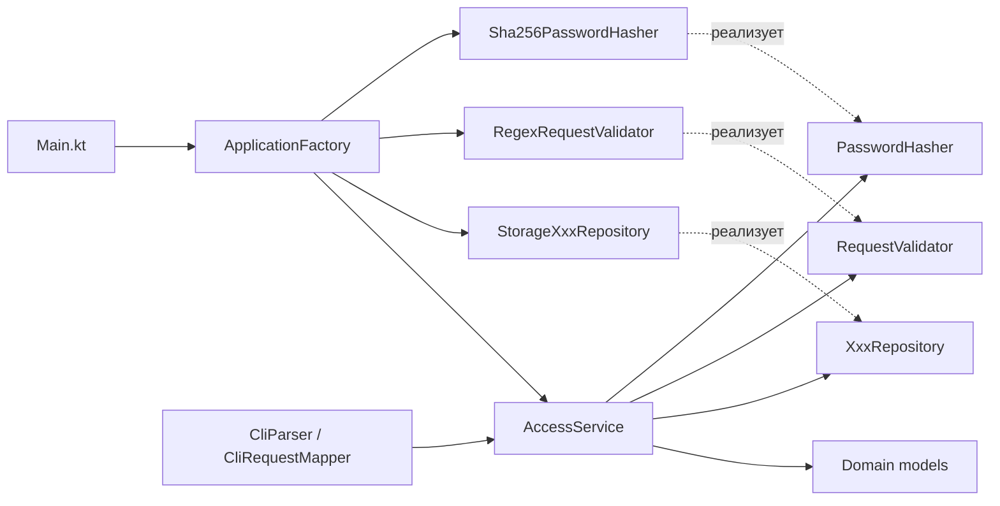

# Чистая архитектура проекта

## Чистая архитектура: кратко

Организация кода, при которой:

1. Бизнес-логика не зависит от инфраструктуры. Домен не знает о БД, CLI, HTTP, фреймворках.
2. Зависимости направлены внутрь. Внешние слои знают о внутренних, не наоборот.
3. Границы пересекаются через абстракции. Внутренний слой объявляет интерфейс, внешний — реализует.
4. Домен тестируется без запуска приложения: ни БД, ни CLI не нужны.

```
┌─────────────────────────────────────────────────────┐
│  Infrastructure (Frameworks & Drivers)              │
│  ┌───────────────────────────────────────────────┐  │
│  │  Interface Adapters                           │  │
│  │  ┌─────────────────────────────────────────┐  │  │
│  │  │  Application (Use Cases)                │  │  │
│  │  │  ┌───────────────────────────────────┐  │  │  │
│  │  │  │  Domain (Entities)                │  │  │  │
│  │  │  └───────────────────────────────────┘  │  │  │
│  │  └─────────────────────────────────────────┘  │  │
│  └───────────────────────────────────────────────┘  │
└─────────────────────────────────────────────────────┘
         ↑ зависимости направлены внутрь ↑
```

## 1. Слои в проекте

Выделяются четыре слоя + composition root.

### 1.1. Domain — ядро

Модели и правила, ни от чего не зависящие. Никаких импортов из `java.security`, `java.io`, CLI.

| Класс | Текущий файл | Пояснение |
|---|---|---|
| `Resource` | `Models.kt` | Доменная сущность ресурса |
| `AccessRule` | `Models.kt` | Доменное правило доступа |
| `User` | `Models.kt` | Доменная сущность пользователя |
| `Action` | `Models.kt` | Перечисление действий |
| `ResourcePath` *(новый)* | — | Value-класс для пути |
| `PasswordHash` *(новый)* | — | Value-класс для хеша |
| `UserRepository` | `AccessService.kt` | Интерфейс репозитория |
| `ResourceRepository` | `AccessService.kt` | Интерфейс репозитория |
| `RuleRepository` | `AccessService.kt` | Интерфейс репозитория |
| `PasswordHasher` *(новый)* | — | Интерфейс хеширования |
| `EffectiveRuleResolver` *(новый)* | — | Наследование прав по пути |

Интерфейсы репозиториев — часть контракта домена. Реализации живут в инфраструктуре, абстракции принадлежат ядру (DIP).

`AccessRequest` в домен **не входит** — это DTO приложения (см. 1.2).

### 1.2. Application — сценарии

Оркестрация доменных объектов. Не знает о CLI, БД и конкретных реализациях.

| Класс | Текущий файл | Пояснение |
|---|---|---|
| `AccessRequest` *(DTO)* | `Models.kt` | Входные данные use case |
| `AccessResult` *(новый)* | — | Результат use case: `Success`, `BadLogin`, `NoAccess`, … |
| `AccessService` | `AccessService.kt` | Тонкий оркестратор после рефакторинга |
| `CheckAccessUseCase` *(новый)* | — | Явный use case проверки доступа |
| `Authenticator` *(новый)* | — | Аутентификация пользователя |
| `AccessResolver` *(новый)* | — | Применение правила к запросу |
| `RequestValidator` *(новый)* | — | Интерфейс валидации запроса |

Почему `Authenticator` и `AccessResolver` здесь, а не в домене. Домен отвечает на вопрос «что такое правило доступа» и «наследуется ли право по пути». Application отвечает на «взять пользователя, найти правило, применить, вернуть результат». Это разные уровни.

### 1.3. Interface Adapters — адаптеры

Преобразование данных между внешним миром и application. CLI-парсинг, маппинг DTO, форматирование ответа, коды возврата процесса.

| Класс / функция | Текущий файл | Пояснение |
|---|---|---|
| `parseKeyValues` | `Cli.kt` | Парсинг аргументов CLI |
| `printHelp` | `Cli.kt` | Вывод справки |
| `CliArgument` *(новый)* | — | Enum CLI-ключей |
| `CliRequestMapper` *(новый)* | — | `Map<String,String>` → `AccessRequest` |
| `ExitCode` *(новый)* | — | Маппинг `AccessResult` → код возврата CLI |

CLI — адаптер входа, как веб-контроллер или gRPC-сервер. Работает с доменом через use case'ы. Инфраструктура — это «железо»: БД, сеть, файлы.

### 1.4. Infrastructure — инфраструктура

Конкретные реализации абстракций домена. Самая внешняя оболочка.

| Класс / функция | Текущий файл | Пояснение |
|---|---|---|
| `Storage` (object) | `Storage.kt` | Захардкоженные данные |
| `StorageUserRepository` | `AccessService.kt` | Реализация `UserRepository` |
| `StorageResourceRepository` | `AccessService.kt` | Реализация `ResourceRepository` |
| `StorageRuleRepository` | `AccessService.kt` | Реализация `RuleRepository` |
| `hashPassword` | `Storage.kt` | Криптография |
| `hexToBytes` | `Storage.kt` | Утилита |
| `InMemoryUserStorage` *(новый)* | — | Хранилище пользователей |
| `InMemoryResourceStorage` *(новый)* | — | Хранилище ресурсов |
| `InMemoryRuleStorage` *(новый)* | — | Хранилище правил |
| `Sha256PasswordHasher` *(новый)* | — | Реализация `PasswordHasher` |
| `RegexRequestValidator` *(новый)* | — | Реализация `RequestValidator` |

### 1.5. Composition root

`Main.kt` и `ApplicationFactory` — не слой. Это единственное место, где разрешено знать обо всех слоях. Собирают граф зависимостей, парсят CLI, вызывают use case, маппят результат в код возврата.

### 1.6. Сводная схема



Сплошные стрелки — зависимости. Пунктирная — реализация интерфейсов.

## 2. Соответствие текущих классов слоям

| Файл | Текущее содержимое | Целевой слой | Комментарий |
|---|---|---|---|
| `Models.kt` | `Resource`, `AccessRule`, `User`, `Action` | Domain | Чистые модели. `User.equals/hashCode` → вынести в `PasswordHash` |
| `Models.kt` | `AccessRequest` | Application (DTO) | Не домен: это форма входных данных use case |
| `Storage.kt` | `Storage`, `hashPassword`, `hexToBytes` | Infrastructure | Разделить на storage + hasher + utils |
| `Validator.kt` | `ResourceValidator` | Application + Infrastructure | Интерфейс → Application, реализация → Infrastructure |
| `AccessService.kt` | `AccessService` | Application | Разбить на use case'ы |
| `AccessService.kt` | `UserRepository`, `ResourceRepository`, `RuleRepository` | Domain | Интерфейсы → домен |
| `AccessService.kt` | `StorageUserRepository`, `StorageResourceRepository`, `StorageRuleRepository` | Infrastructure | Реализации → инфраструктура |
| `Cli.kt` | `EXIT_*`, `REQUIRED_KEYS`, `parseKeyValues`, `printHelp` | Interface Adapters | Разделить на `CliArgument`, `CliParser`, `HelpPrinter`, `ExitCode` |
| `Main.kt` | `main()` | Composition root | Тонкий `main` + `ApplicationFactory` |

## 3. Направление зависимостей

Правило: зависимости направлены внутрь.

```
Composition root ──→ Infrastructure ──→ Application ──→ Domain
Composition root ──→ Adapters       ──→ Application ──→ Domain
```

На практике:

- Domain не импортирует ничего из Application, Adapters, Infrastructure. Ни одного `import java.security.*`, ни одного `import kotlin.system.exitProcess`.
- Application не импортирует конкретные реализации из Infrastructure — только интерфейсы из Domain.
- Infrastructure импортирует всё, что нужно.
- Composition root знает обо всех слоях — единственное разрешённое исключение.

Инверсия зависимостей на примере `PasswordHasher`:

```
Domain:          interface PasswordHasher                        ← объявлен здесь
Infrastructure:  class Sha256PasswordHasher : PasswordHasher     ← реализован здесь
Application:     class Authenticator(private val hasher: PasswordHasher)
                 ← зависит от абстракции, не от реализации
```

## 4. План реструктуризации

### 4.1. Целевая структура пакетов

```
src/
├── domain/                          ← ядро, ни от чего не зависит
│   ├── model/
│   │   ├── Resource.kt
│   │   ├── AccessRule.kt
│   │   ├── User.kt
│   │   ├── Action.kt
│   │   ├── ResourcePath.kt          ← новый value-класс
│   │   └── PasswordHash.kt          ← новый value-класс
│   ├── repository/
│   │   ├── UserRepository.kt
│   │   ├── ResourceRepository.kt
│   │   └── RuleRepository.kt
│   └── service/
│       ├── PasswordHasher.kt        ← новый интерфейс
│       └── EffectiveRuleResolver.kt ← новое доменное правило
│
├── application/                     ← сценарии
│   ├── dto/
│   │   ├── AccessRequest.kt
│   │   └── AccessResult.kt
│   ├── AccessService.kt             ← тонкий оркестратор
│   ├── Authenticator.kt             ← новый
│   ├── AccessResolver.kt            ← новый
│   └── validation/
│       └── RequestValidator.kt      ← новый интерфейс
│
├── presentation/                    ← Interface Adapters
│   └── cli/
│       ├── CliParser.kt
│       ├── HelpPrinter.kt
│       ├── ExitCode.kt
│       ├── CliArgument.kt
│       └── CliRequestMapper.kt
│
├── infrastructure/                  ← реализации
│   ├── storage/
│   │   ├── InMemoryUserStorage.kt
│   │   ├── InMemoryResourceStorage.kt
│   │   └── InMemoryRuleStorage.kt
│   ├── repository/
│   │   ├── StorageUserRepository.kt
│   │   ├── StorageResourceRepository.kt
│   │   └── StorageRuleRepository.kt
│   ├── security/
│   │   └── Sha256PasswordHasher.kt
│   ├── validation/
│   │   └── RegexRequestValidator.kt
│   └── utils/
│       └── Hex.kt
│
├── ApplicationFactory.kt            ← composition root
└── Main.kt                          ← тонкая точка входа
```

### 4.2. Что и куда переносится

| Что | Откуда | Куда | Причина |
|---|---|---|---|
| `Resource`, `AccessRule`, `User`, `Action` | `Models.kt` | `domain/model/` | Чистые доменные модели |
| `AccessRequest` | `Models.kt` | `application/dto/` | DTO use case, не домен |
| `UserRepository`, `ResourceRepository`, `RuleRepository` | `AccessService.kt` | `domain/repository/` | Абстракции принадлежат домену |
| `AccessService` | `AccessService.kt` | `application/` | Оркестратор сценариев |
| `Storage` | `Storage.kt` | `infrastructure/storage/` (разбить на 3) | Инфраструктура |
| `hashPassword` | `Storage.kt` | `infrastructure/security/Sha256PasswordHasher` | Отдельная ответственность |
| `hexToBytes` | `Storage.kt` | `infrastructure/utils/Hex.kt` | Утилита |
| `StorageXxxRepository` | `AccessService.kt` | `infrastructure/repository/` | Реализации абстракций |
| `ResourceValidator` | `Validator.kt` | `application/validation` + `infrastructure/validation` | Разделить интерфейс и реализацию |
| `parseKeyValues` | `Cli.kt` | `presentation/cli/CliParser.kt` | Адаптер |
| `printHelp` | `Cli.kt` | `presentation/cli/HelpPrinter.kt` | Адаптер |
| `EXIT_*` | `Cli.kt` | `presentation/cli/ExitCode.kt` | Enum вместо констант |
| `Main` | `Main.kt` | оставить в корне, оставить тонким | Composition root |

### 4.3. Какие абстракции добавить

| Интерфейс | Слой | Назначение | Кто реализует |
|---|---|---|---|
| `PasswordHasher` | `domain/service` | Хеширование и сравнение паролей | `Sha256PasswordHasher` |
| `RequestValidator` | `application/validation` | Валидация запроса | `RegexRequestValidator` |
| `EffectiveRuleResolver` | `domain/service` | Наследование прав по пути | (реализация в домене) |

Отдельные интерфейсы `UserStorage`, `ResourceStorage`, `RuleStorage` не вводятся: три существующих репозитория уже покрывают поиск. Если понадобится заменить источник данных (файл, БД), интерфейс репозитория — достаточная точка расширения.

```kotlin
// domain/service/PasswordHasher.kt
interface PasswordHasher {
    fun hash(password: String, salt: ByteArray): ByteArray
    fun verify(password: String, salt: ByteArray, expected: PasswordHash): Boolean
}
```

```kotlin
// application/validation/RequestValidator.kt
interface RequestValidator {
    fun validate(request: AccessRequest): AccessResult?
}
```
### 4.4. Направление зависимостей после рефакторинга



Ни одна стрелка не идёт от Domain наружу.

### 4.5. Пошаговый план

Порядок выбран так, чтобы после каждого шага проект собирался и работал.

1. **Выделить `domain/model/`:**
   - Перенести `Resource`, `AccessRule`, `User`, `Action`.
   - Добавить value-классы `ResourcePath`, `PasswordHash`.
   - Убедиться: в пакете нет ни одного `import java.*`.

2. **Выделить `domain/repository/`:**
   - Перенести интерфейсы `UserRepository`, `ResourceRepository`, `RuleRepository`.

3. **Выделить `domain/service/`:**
   - Добавить `PasswordHasher`.
   - Вынести логику `findEffectiveRule` в `EffectiveRuleResolver`.

4. **Выделить `application/`:**
   - Перенести `AccessRequest` в `application/dto/`, добавить `AccessResult`.
   - Разбить `AccessService.check` на `Authenticator`, `AccessResolver`, `RequestValidator`.
   - Сам `AccessService` оставить тонким.

5. **Выделить `presentation/cli/`:**
   - Разделить `Cli.kt` на `CliArgument`, `CliParser`, `HelpPrinter`, `ExitCode`.
   - Добавить `CliRequestMapper` для преобразования в `AccessRequest`.

6. **Выделить `infrastructure/`:**
   - Разделить `Storage` на три хранилища.
   - Перенести `hashPassword` в `Sha256PasswordHasher`, `hexToBytes` — в `Hex`.
   - Перенести реализации репозиториев.
   - Реализовать `RegexRequestValidator`.
   - Создать `ApplicationFactory`.

7. **Переписать `Main.kt`:**
   - Тонкий `main()`: парсинг → валидация → `ApplicationFactory.create()` → вызов → маппинг `AccessResult` в `ExitCode`.

8. **Обновить `build.sh` / `run.sh` / `test.sh`:**
   - Прописать новые пути к исходникам, если изменилась структура `src/`.

9. **Прогнать тесты:**
   - `./test.sh` должен проходить 10/10.

10. **Обновить `README.md`:**
    - Отразить новую структуру пакетов.

В рамках ЛР3 рефакторинг не выполняется — это план на следующие работы.

### 4.6. Что остаётся неизменным

Поведение приложения не меняется: те же коды возврата, тот же парсинг CLI, те же данные в `Storage`. Меняются только расположение классов и направление зависимостей.
